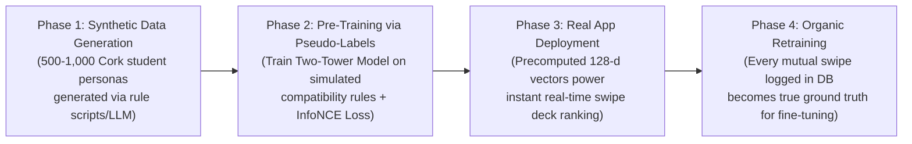

# Two-Tower Reciprocal Recommender Engine: Architecture & Cold-Start Training Guide

## 1. Overview & Problem Definition

In **SyncScape (RoommateTinder)**, roommate recommendation is a **Reciprocal Recommender System** (unlike Netflix or Amazon, both parties must match and agree).

The matching engine ranks potential roommates for Tab 2 (Roommate Swipe Deck) using a **Two-Tower Neural Network (Dual Encoder)** in PyTorch.

---

## 2. Solving the Cold-Start Data Problem (No Initial Swipes)

A major hurdle for any new recommender system is the **Cold-Start Interaction Problem**: on Day 1 of the platform, there are **0 swipe logs** and no historical positive/negative pairs.

### The 3-Phase Strategy



1. **Synthetic Personas (Phase 1):** We simulate realistic Cork student profiles (UCC, MTU) with distributions across budgets (€450–€1,000), sleep routines, cleanliness scales (1–5), and personality prompts.
2. **Pseudo-Labeling via Domain Rules (Phase 2):** A deterministic "teacher" function pairs users based on housing compatibility criteria (budget overlap, matching social habits, similar cleanliness). These simulated positive pairs form our initial training set.
3. **Organic Data Collection (Phase 4):** As real users swipe right/left in the app, their interactions are logged to a PostgreSQL/SQLite database to continuously retrain and refine the embeddings.

---

## 3. High-Level Architecture

For roommate matching, we use a **Siamese Two-Tower architecture** (both towers share weights because both users are tenants).

```
Tenant A (Swiper)                               Tenant B (Candidate)
┌──────────────────────────────┐                ┌──────────────────────────────┐
│ • Categorical (Sleep, Pets)  │                │ • Categorical (Sleep, Pets)  │
│ • Numerical (Cleanliness 1-5)│                │ • Numerical (Cleanliness 1-5)│
│ • Budget & Location (Cork)   │                │ • Budget & Location (Cork)   │
│ • 384-d Prompt Text Embedding│                │ • 384-d Prompt Text Embedding│
└──────────────┬───────────────┘                └──────────────┬───────────────┘
               │                                               │
               ▼                                               ▼
       ┌───────────────┐                               ┌───────────────┐
       │ RoommateTower │                               │ RoommateTower │
       │ (Shared MLP)  │                               │ (Shared MLP)  │
       └───────┬───────┘                               └───────┬───────┘
               │                                               │
               ▼                                               ▼
     L2-Normalized Embedding                         L2-Normalized Embedding
         $u_A \in \mathbb{R}^{128}$                      $u_B \in \mathbb{R}^{128}$
               │                                               │
               └───────────────────────┬───────────────────────┘
                                       │
                                       ▼
                       Dot Product / Cosine Similarity
                                $S(A, B) = u_A^\top u_B$
                                       │
                                       ▼
                       Compatibility Match Score (0 - 100%)
```

---

## 4. Concrete Example: Training Dynamics Across Iterations

To understand how the neural network learns from in-batch negatives without explicit manual labels, consider a mini-batch of 2 positive pairs:
* **Positive Pair 1:** `(Liam, Sean)` — UCC Medicine & MTU Engineering (Early birds, clean 5/5, quiet study).
* **Positive Pair 2:** `(Aoife, Chloe)` — UCC Arts (Night owls, social/party lovers, relaxed cleanliness).

### Iteration 0: Random Initialization (Untrained)
At the start, the model's weights are random numbers. The output vectors are arbitrary:

$$\text{Similarity Matrix} = \begin{pmatrix} & \text{Sean (Target 1)} & \text{Chloe (Target 2)} \\ \text{Liam (User 1)} & \mathbf{0.14} & 0.62 \\ \text{Aoife (User 2)} & 0.48 & \mathbf{0.08} \end{pmatrix}$$

* **What happened?** Purely by chance, Liam has higher similarity with Chloe ($0.62$) than with his true match Sean ($0.14$).
* **InfoNCE Loss:** High error ($\mathcal{L} \approx 2.85$).
* **Backpropagation:** The optimizer computes gradients to push $u_{\text{Liam}}$ and $u_{\text{Sean}}$ together, while pulling $u_{\text{Liam}}$ and $u_{\text{Chloe}}$ apart.

---

### Iteration 50: Learning Coarse Rules
After 50 batches, the embedding layers discover tabular constraints:
* The categorical layer maps `sleep_schedule: Early Bird` far away from `Night Owl`.
* Cleanliness gaps $> 2$ receive negative weight contributions.

$$\text{Similarity Matrix} = \begin{pmatrix} & \text{Sean} & \text{Chloe} \\ \text{Liam} & \mathbf{0.58} & 0.18 \\ \text{Aoife} & 0.22 & \mathbf{0.61} \end{pmatrix}$$

* **Loss drops to $\approx 0.82$**.

---

### Iteration 200: Semantic Nuance & Prompt Alignment
The network learns to align the 384-dimensional text embeddings from the personality prompt answers:
* *"I study for hospital rounds until 10 PM"* is projected close to *"Quiet after 9 PM, focused on studies"*, despite completely different vocabularies.

$$\text{Similarity Matrix} = \begin{pmatrix} & \text{Sean} & \text{Chloe} \\ \text{Liam} & \mathbf{0.93} & -0.42 \\ \text{Aoife} & -0.38 & \mathbf{0.91} \end{pmatrix}$$

* Ground-truth pairs on the diagonal have strong positive alignment ($> 0.90$).
* Incompatible pairs have negative alignment ($< -0.35$).
* **Loss converges to $\approx 0.15$**.

---

## 5. Complete PyTorch Implementation

### 5.1 Synthetic Data Generator & Pseudo-Labeler

```python
import random
import torch
import pandas as pd
from typing import List, Tuple

def generate_synthetic_cork_students(n: int = 1000) -> pd.DataFrame:
    colleges = ["UCC", "MTU"]
    sleep_types = [0, 1, 2]       # 0: Early Bird, 1: Moderate, 2: Night Owl
    social_types = [0, 1, 2]      # 0: Quiet/Homebody, 1: Balanced, 2: Social/Party
    noise_tolerance = [0, 1, 2]   # 0: Low, 1: Moderate, 2: High
    
    sample_prompts = {
        0: "I prefer quiet study evenings, tea, and early nights.",
        1: "Enjoy social weekends, but strict quiet study hours during weekdays.",
        2: "Love weekend drinks, music, cooking together, and having friends over."
    }

    records = []
    for i in range(n):
        social = random.choice(social_types)
        min_budget = random.randint(450, 850)
        max_budget = min_budget + random.randint(100, 250)
        cleanliness = random.randint(1, 5)

        records.append({
            "user_id": f"student_{i:04d}",
            "college": random.choice(colleges),
            "budget_min": min_budget,
            "budget_max": max_budget,
            "sleep_schedule": random.choice(sleep_types),
            "social_habit": social,
            "noise_tolerance": random.choice(noise_tolerance),
            "cleanliness": cleanliness,
            "prompt_text": sample_prompts[social]
        })
    return pd.DataFrame(records)

def create_pseudo_labeled_pairs(df: pd.DataFrame) -> List[Tuple[dict, dict]]:
    """
    Pairs users together who satisfy mutual baseline criteria:
    1. Overlapping budget ranges
    2. Cleanliness score within +/- 1
    3. Same social habits
    """
    positive_pairs = []
    for _, user_a in df.iterrows():
        candidates = df[
            (df['user_id'] != user_a['user_id']) &
            (df['budget_min'] <= user_a['budget_max']) &
            (df['budget_max'] >= user_a['budget_min']) &
            (abs(df['cleanliness'] - user_a['cleanliness']) <= 1) &
            (df['social_habit'] == user_a['social_habit'])
        ]
        if not candidates.empty:
            user_b = candidates.sample(1).iloc[0]
            positive_pairs.append((user_a.to_dict(), user_b.to_dict()))
    return positive_pairs
```

---

### 5.2 Two-Tower Model Architecture (PyTorch)

```python
import torch
import torch.nn as nn
import torch.nn.functional as F

class RoommateTower(nn.Module):
    """
    Single tower projecting tabular features + text prompt embeddings
    into a normalized 128-dimensional latent space.
    """
    def __init__(
        self,
        cat_cardinalities: dict = {'sleep': 3, 'social': 3, 'noise': 3},
        embedding_dim: int = 8,
        num_continuous: int = 3,       # normalized min_budget, max_budget, cleanliness
        text_embedding_dim: int = 384, # Sentence-Transformers output dim
        output_dim: int = 128
    ):
        super().__init__()
        
        # Categorical embedding tables
        self.cat_embeddings = nn.ModuleDict({
            feat: nn.Embedding(cardinality, embedding_dim)
            for feat, cardinality in cat_cardinalities.items()
        })
        
        total_input_dim = (len(cat_cardinalities) * embedding_dim) + num_continuous + text_embedding_dim
        
        # Multi-Layer Perceptron (Projection Head)
        self.mlp = nn.Sequential(
            nn.Linear(total_input_dim, 256),
            nn.BatchNorm1d(256),
            nn.ReLU(),
            nn.Dropout(0.1),
            nn.Linear(256, output_dim),
            nn.BatchNorm1d(output_dim)
        )

    def forward(self, cat_dict: dict, cont_tensor: torch.Tensor, text_tensor: torch.Tensor):
        embedded_cats = [self.cat_embeddings[k](cat_dict[k]) for k in self.cat_embeddings]
        cat_features = torch.cat(embedded_cats, dim=-1)
        
        # Concatenate tabular + text modalities
        x = torch.cat([cat_features, cont_tensor, text_tensor], dim=-1)
        latent = self.mlp(x)
        
        # L2-normalization so that dot product equals cosine similarity
        return F.normalize(latent, p=2, dim=-1)


class TwoTowerMatcher(nn.Module):
    def __init__(self, tower: RoommateTower):
        super().__init__()
        self.tower = tower
        self.temperature = nn.Parameter(torch.ones([]) * 0.07)

    def forward(self, user_a_data, user_b_data):
        u_a = self.tower(user_a_data['cat'], user_a_data['cont'], user_a_data['text'])
        u_b = self.tower(user_b_data['cat'], user_b_data['cont'], user_b_data['text'])
        
        # Compute cosine similarity matrix between all users in batch
        sim_matrix = torch.matmul(u_a, u_b.T) / self.temperature
        return sim_matrix


def info_nce_loss(sim_matrix: torch.Tensor) -> torch.Tensor:
    """
    Symmetric contrastive cross-entropy loss with in-batch negatives.
    """
    batch_size = sim_matrix.size(0)
    labels = torch.arange(batch_size, device=sim_matrix.device)
    loss_a = F.cross_entropy(sim_matrix, labels)
    loss_b = F.cross_entropy(sim_matrix.T, labels)
    return (loss_a + loss_b) / 2.0
```

---

## 6. Real-Time Production Serving

When a user signs up or edits their profile:
1. Pass their profile once through `RoommateTower` $\rightarrow$ generate fixed 128-d vector $u$.
2. Store vector $u$ in SQLite/PostgreSQL (or FAISS index).
3. When the user opens the **Roommate Swipe Tab (Tab 2)**:
   * Load their vector $u_{\text{current}}$.
   * Run dot products against all active candidate vectors:
     $$\text{Score} = \frac{u_{\text{current}}^\top u_i + 1}{2} \times 100\%$$
   * Return ranked candidate cards ordered by compatibility score.
   * Execution time: **$< 2 \text{ ms}$** across thousands of profiles.
